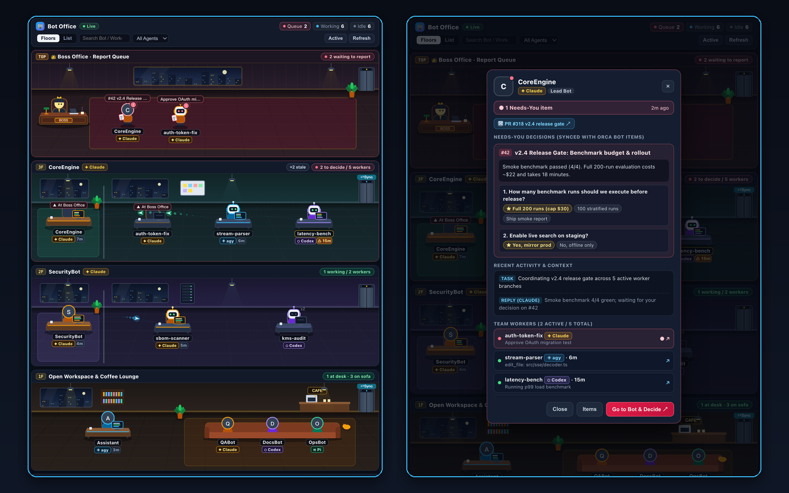

# Bot Office — Orca Plugin

An ultra-lightweight **2.5D Side-Scrolling Stacked AI HQ & Grouped Workbench** for Orca's right sidebar. Bots needing your decision ride upstairs to queue in the **Penthouse Boss Office**, while every team gets its own spacious horizontal floor with unmistakable agent engine badges (`Claude`, `agy`, `Codex`, `Pi`), sleek luminous message streams, and near-zero GPU/CPU overhead.

[中文说明](#中文说明)



## Features

- **2.5D Side-Scrolling Stacked Floors (`<canvas>`)**: Full-width oblique rooms (classic beat-'em-up / DNF depth perspective) with zero wasted corners — straight back walls, night-city skyline windows, elevator doors, perspective floors, glass-partitioned **Team Floors**, and a cozy **Open Workspace & Coffee Lounge** on `1F`.
- **Penthouse Boss Office (`TOP`) with Decision Queue**: Any Bot or Worker synced with Orca's native `Needs you` items (or terminal approval blockers) leaves its desk and queues neatly in front of the Boss Desk holding a report clipboard. Click its soft-rose badge to jump straight to that Bot in Orca, or click the character for a clean preview card.
- **Unmistakable Agent Engine Identity**: Every Bot and Worker displays a color-coded engine emblem badge (`✦ Claude`, `◈ agy`, `⬡ Codex`, `π Pi`) alongside matching uniform, desk trim, and robot visor accents.
- **Sleek Luminous Message Streams**: Minimalist glowing paper-dart packets with fading light trails glide smoothly between Lead Bots and active Workers — clean, airy, and readable.
- **Ultra-Lightweight Architecture**: Zero `backdrop-filter` blur passes, zero infinite CSS animations, offscreen static floor background cache, 0 FPS on idle floors / ≤6 FPS only on active floors (auto-pauses when hidden), and hash-diffed event-driven worker updates.

## Install

```bash
orca plugin install TornadoDai/orca-bot-office
```

Or in Orca: **Settings → Plugins → Install from Git** with `https://github.com/TornadoDai/orca-bot-office`.

## Settings

| Setting | Default | Description |
| --- | --- | --- |
| `refreshIntervalSeconds` | `25` | Background fallback refresh interval (8–120s) |
| `soloBotsInLounge` | `true` | Group solo Bots (0 Workers) in the Open Workspace & Coffee Lounge |
| `hideStaleIdleHours` | `24` | Auto-collapse idle Workers older than N hours (`0` = show all) |
| `showStandaloneWorkspaces` | `true` | Show non-Bot workspaces in the collapsible B1 Hot-Desk bar |
| `language` | `auto` | UI language (`auto`, `en`, `zh`) |

---

## 中文说明

挂在 Orca 右侧栏的**超轻量 2.5D 横版平面分层「AI 总部大楼」+ 分组工作台插件（Bot 工位）**。

- **横版 2.5D 平面分层（DNF 透视视角）**：告别拥挤的菱形等距斜角，每一层铺满侧栏宽度——直墙 + 夜景落地窗 + 右侧电梯间 + 纵深地板；每个带 Worker 的 Bot 独享一整层（多排自动扩展不挤压），单兵 Bot 入驻 1F 开放工区与咖啡茶水间。
- **顶层「👑 老板房」排队汇报**：凡是有原生 `Needs you` 待决策事件或终端等待审批的 Bot / Worker，会自动离开工位上楼，在老板桌前的红毯上举着汇报板整齐排队；轻点柔和珊瑚红标一步直跳对应 Bot 原生界面决策，点击角色查看完整摘要与推荐项。
- **底层代理一眼分辨**：所有 Bot、Worker 工位与列表均挂载高辨识度配色代理徽章（`✦ Claude` 琥珀、`◈ agy` 天蓝、`⬡ Codex` 紫罗兰、`π Pi` 翠绿），同步映射至服装、工位灯带与机器人面罩配色。
- **轻量流光消息传递 & 柔和提醒**：用极简流光纸箭 + 渐隐光点轨迹替代厚重信封；全界面改用柔和珊瑚粉/玫瑰红提醒，醒目不刺眼。
- **极度轻量低占用**：零 `backdrop-filter`、零 60 FPS CSS 动画、静态背景离屏缓存 + 静止楼层 0 FPS / 活跃楼层 ≤6 FPS + 后台哈希去重。

### 安装方式

```bash
orca plugin install TornadoDai/orca-bot-office
```

## License

MIT
