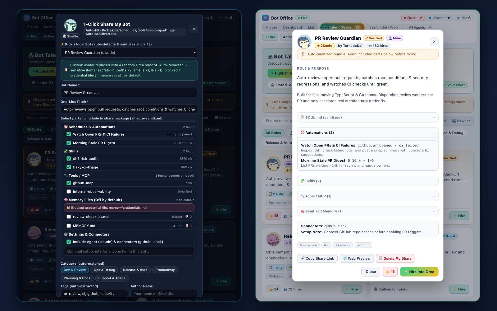
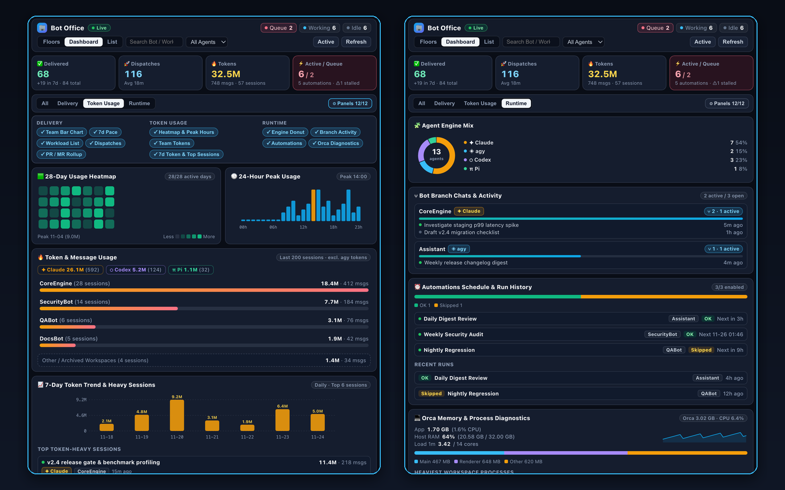
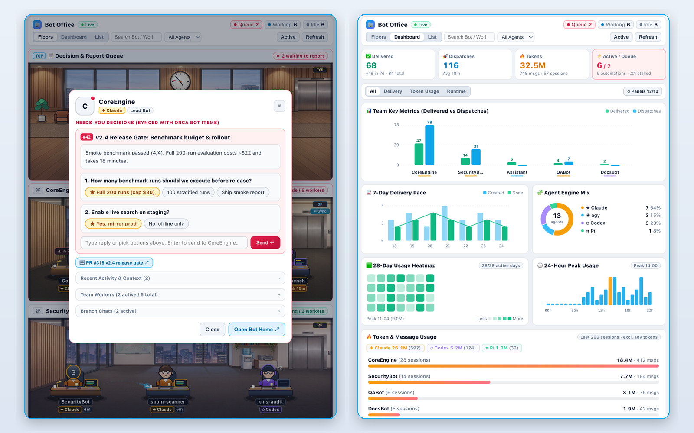

# Bot Office — Orca Plugin

An ultra-lightweight **2.5D Illustrated Office Tower + Built-In Bot Talent Market** for Orca's right sidebar. Discover, upvote, and 1-click hire **24 official Orca Bot templates** and community-shared Bots straight into your office tower — or 1-click share your own Bot with automatic secret redaction, selectable bundles (schedules, skills, MCP tools, memory, settings), and instant self-delete. Meanwhile, Bots needing your decision queue in the furnished **Decision & Report Suite**, idle workers relax with coffee/TV/music, and a categorized SVG analytics dashboard tracks delivery, tokens, and runtime health.

[中文说明](#中文说明)


## Gallery

### 1-Click Auto-Sanitized Sharing, Bundle Picker & Light-Theme Resume Audit


### Categorized Dashboard, 12-Panel Switch Drawer & Magpie-Style Usage Charts


### Native Light Theme & Interactive In-Card Decision Reply


## Features

- **🏪 Built-In Bot Talent Market ("Plugin-within-a-Plugin")**: Prominent glowing top-bar entry, collapsible lobby showcase banner, and `+ Hire` bridge. Pre-populated with all **24 official Orca Bot templates** (bilingual EN/ZH) alongside live community listings (Cloudflare Worker + D1 with multi-CDN read-only fallback).
  - **1-Click Auto-Fill & Privacy Sanitizer**: Pick any local Bot to auto-extract its `SOUL.md`, **Schedules & Automations**, **Skills**, **MCP Tools** (secrets stripped), optional **Memory files** (off by default, credential files like `memory/credentials.md` hard-blocked), and **Settings**. Automatically redacts keys/tokens/emails/IPs/local paths locally and on the server, replaces custom uploaded avatars with a random official Orca mascot (+ `🎲 Shuffle`), and generates an instant shareable link (`/s/<code>`).
  - **Native Safe Hire, Upvotes & Self-Delete**: Audit every included module before clicking **Hire** (launches Orca's native Create Bot card or `orca://bots/share/<id>`), upvote favorites, and manage or permanently delete your own shared Bots anytime under **Published by Me**.
- **Illustrated 2.5D Modern Office Tower (`<canvas>`)**: Warm painted high-rise office backdrops (furnished executive briefing suite with a **live real-time circular wall clock**, glass-partitioned startup studios with twilight skylines, and a cozy `1F` espresso café lounge), native rendering of all **20 official Orca mascots**, grounded bottom-up floor stacking, and 5 playful idle-worker slacking activities (coffee, phone, TV, music, nap).
- **Interactive Decision-First Card (`TOP` Report Queue)**: Any Bot or teammate synced with Orca's native `Needs you` items queues in front of the unlabeled executive desk (empty chair by default, or optional custom avatar via `ownerAvatarMode` / `ownerAvatarPath`) holding a report clipboard. Click to view the **exact active decision context** (full `--after` pagination matching `item.question.eventId`, clickable URLs, zero scroll clutter), pick options, and hit **Enter** to route your answer straight back to that Bot's item chat.
- **In-Office Bot Hiring (`+ Hire`) & Clickable Executive Chair**: Click **`+ Hire`** in the top bar to recruit a new Bot through your HR/Creator Bot — supporting both **Direct Create Card** (`orca bot create --offer`) and **Discuss with HR First**. Click the **TOP floor executive chair** directly anytime to switch between **Empty Chair**, **Silhouette**, or **Custom Image** (with built-in local image upload).
- **Native Light & Dark Themes**: Automatically follows Orca's Light and Dark color schemes across the floor cards, SVG analytics charts, tables, and inspector modal.
- **Human-Styled Teammates & Agent Engine Identity**: Expressive human-styled colleagues (unique hairstyles, glasses/headphones, 3D-shaded outfits) and Lead Bots display color-coded engine badges (`✦ Claude`, `◈ agy`, `⬡ Codex`, `π Pi`) everywhere at a glance.
- **Branch Chat Awareness (`⑂N`)**: Bots with open branch chats display a calm teal `⑂N` badge on the **top-left** of their avatar (never conflicting with the top-right coral-rose `Needs you` alert) and in List view, stay awake at their desks while a branch chat is active, and auto-expand active branch chats inside the Inspector Card when no decisions are pending.
- **Categorized Dashboard & 12-Panel Switch Drawer (`Floors | Dashboard | List`)**: Pure-SVG right-sidebar data panel synced live with Engine & Search filters. Always shows the 4 Core KPI cards, plus category tabs (`All | Delivery | Token Usage | Runtime`) and a collapsible **`⚙ Panels`** drawer letting you toggle all 12 charts & panels individually (disabled lazy modules skip their CLI calls for 0ms overhead):
  - **Delivery**: Team Key Metrics bar chart, 7-day delivery pace, Team Workload ranking, Worker Dispatch efficiency, Linked PR / MR / Issue rollup.
  - **Token Usage** *(Magpie-inspired)*: **28-Day Usage Heatmap (4×7)**, **24-Hour Peak Usage bar chart**, Team Token & Message rankings, 7-Day Token Trend & Top Heavy Sessions (`history:read`).
  - **Runtime**: Agent Engine Mix donut, Bot Branch Chats & Activity, Automations Schedule & Run History (with outcome ratio bar), Orca Memory Sparkline & Process Diagnostics.
- **Ultra-Lightweight Architecture**: Zero `backdrop-filter` blur passes, zero external chart libraries, zero infinite CSS animations, offscreen static floor background cache, 0 FPS on idle floors / ≤3.5 FPS only on active floors (auto-pauses when hidden), and hash-diffed event-driven worker updates.

## Install

```bash
orca plugin install TornadoDai/orca-bot-office
```

Or in Orca: **Settings → Plugins → Install from Git** with `https://github.com/TornadoDai/orca-bot-office`.

## Settings

| Setting | Default | Description |
| --- | --- | --- |
| `refreshIntervalSeconds` | `25` | Background fallback refresh interval (8–120s) |
| `soloBotsInLounge` | `true` | Group solo Bots (0 Workers) in the Open Workspace & Coffee Lounge |
| `hideStaleIdleHours` | `24` | Auto-collapse idle Workers older than N hours (`0` = show all) |
| `showStandaloneWorkspaces` | `true` | Show non-Bot workspaces in the collapsible B1 Hot-Desk bar |
| `ownerAvatarMode` | `empty` | Top-floor center chair display (`empty` invisible, `custom` image, `silhouette`) |
| `ownerAvatarPath` | `""` | Local image path used when `ownerAvatarMode` is `custom` |
| `dashShowTokenDetails` | `true` | Dashboard: show 7-day daily token trend & top heavy sessions |
| `dashShowBranchChats` | `true` | Dashboard: show Bot branch chats & activity |
| `dashShowAutomations` | `true` | Dashboard: show automation schedule & recent runs |
| `dashShowLinkedRefs` | `true` | Dashboard: show team PR / MR / Issue rollup |
| `dashShowDiagnostics` | `true` | Dashboard: show Orca memory & process diagnostics |
| `marketApiUrl` | built-in Worker URL | Custom Talent Market API URL (leave empty to use the built-in Cloudflare Worker + CDN mirror) |
| `language` | `auto` | UI language (`auto`, `en`, `zh`) |

---

## 中文说明

挂在 Orca 右侧栏的**超轻量 2.5D 写字楼「AI 总部大楼」+ 内置「Bot 人才市场」插件**。


- **🏪 内置 Bot 人才市场（插件里的插件）**：顶部高亮入口 + 大厅可折叠推荐栏 + `+ 招新` 弹窗直达，内置全部 **24 个 Orca 官方岗位模板**与实时社区分享（Cloudflare Worker + D1，内置多 CDN 只读镜像回退）。
  - **一键自动识别、可选打包与自动脱敏**：选中本机 Bot 自动提取并脱敏 `SOUL.md`、**定时任务/自动化**、**技能（Skills）**、**工具/MCP**（自动剥离密钥）、**记忆文件**（默认不勾选，自动硬拦截 `credentials.md` 等敏感凭据文件）与**设置提示**；自定义上传头像自动随机替换为 19 个 Orca 官方吉祥物（支持 `🎲 换头像`），一键生成公开分享链接（`/s/<code>`）。
  - **安全审查、点赞与本人彻底删除**：招聘前可展开审查全部脱敏配置，点击「一键招聘」唤起 Orca 原生创建卡；支持「👤 我发布的」筛选与本人两步确认彻底删除（原链接立即 404 失效）。
- **真实立体感现代写字楼插画分层**：采用 2.5D 精绘暖光写字楼室内实景底图，完整渲染全部 **20 个 Orca 官方吉祥物**，支持落地式自下而上排桌与 5 种空闲 Worker 摸鱼彩蛋（喝咖啡、刷手机、看电视、听歌、打盹）；顶层为配备**实时走时挂钟**的精装决策汇报区，静态背景离屏缓存零渲染负担。
- **顶层「决策汇报区」+ 卡片内直接决策回复**：中央设置无文字原木工位（默认空椅隐形，可在插件设置里自定义头像 `ownerAvatarMode` / `ownerAvatarPath`），所有待决策 Bot 整齐在前方排队汇报；点开卡片精确翻页（`--after`）匹配当前最新待决策事件，完整呈现未截断上下文与可点选项，支持直接点选或回车把答复发回对应 Bot 聊天继续推进。
- **办公室内直接招新（`+ 招新`）& 汇报区工位点选换形象**：顶栏新增 **`+ 招新`** 按钮，可选择负责招聘的 HR Bot，同时支持**「直接出创建卡」**与**「和 HR 先聊需求」**两种方式；直接点击顶层汇报区**中央皮椅/办公桌**即可随时切换「空椅隐形 / 极淡剪影 / 上传任意本地头像图片」，无需再去设置页手填路径。
- **原生浅色 / 深色双主题**：顶栏、楼层卡片、仪表盘 SVG 图表与详情卡片全部响应 Orca 浅色与深色主题切换。
- **拟人化团队成员 & 代理一眼分辨**：Worker 为带不同发型、眼镜/耳机与立体光影穿搭的研发同事形象，搭配高辨识度配色代理徽章（`✦ Claude` 琥珀、`◈ agy` 天蓝、`⬡ Codex` 紫罗兰、`π Pi` 翠绿）。
- **分支聊天轻感知（`⑂N` 不与红点冲突）**：有活跃分支聊天的 Bot 在头像**左上角**显示青绿色 `⑂N` 角标（与右上角珊瑚红待决策提醒彻底隔离），近期活跃时工位保持亮屏不睡大觉，无待决策项时详情卡片自动展开活跃分支。
- **分类仪表盘 + 12 项全量可开关抽屉 + Magpie 风格统计图表**：保留顶部 4 张核心 KPI 卡片常驻，下方提供 **`全部 | 团队交付 | Token 用量 | 运行态`** 分类页签与 **`⚙ 面板开关`** 抽屉，可按需启停近 28 天活跃热力图、24 小时用量峰值柱图、7 天 Token 趋势与最耗会话榜、分支聊天活跃度、定时任务排期与运行占比条、关联 PR/MR/Issue 汇总、Orca 内存走势折线图与高占用进程诊断（关闭后跳过对应 CLI 采集，零开销）。
- **极度轻量低占用**：零 `backdrop-filter`、零外部图表库、零 60 FPS CSS 动画、静态底图离屏缓存 + 静止楼层 0 FPS / 活跃楼层 ~3.5 FPS + 仪表盘按需 60s 缓存。

### 安装方式

```bash
orca plugin install TornadoDai/orca-bot-office
```

## License

MIT
